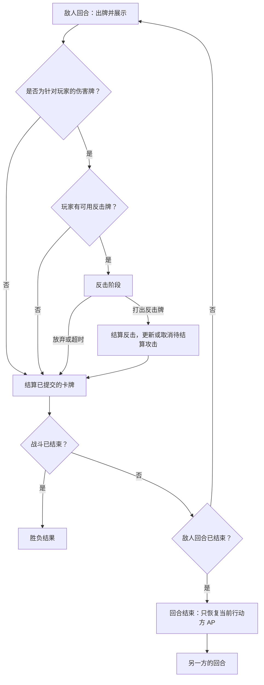

# 演出式 QTE — 设计

状态：用户确认的回合制设计；核心规则与浏览器流程已实现并验证。更新日期：2026-10-14。
上游：[PRD](prd.md)；用户最新纠正优先于此前的 Response 循环需求。

## 回合制战斗约定

本游戏是回合制卡牌对战。一个**回合**属于当前行动方；**反击阶段（Counter）**是插入该回合的应对阶段，不是独立回合。如果界面或冷却计数仍使用轮次／循环，不得将它与敌人的单次攻击混为一谈。未来实现将替换旧的“敌方前摇 → 玩家应对（Response）→ 玩家普通行动 → 反击”流程。现有代码与此前验证仍描述旧的可玩原型。

已确定的敌人回合流程：

1. 敌人打出一张牌。先提交这张牌，并立即在右上角展示，再检查应对条件；显示卡牌不得依赖反击是否可用。
2. 检查已提交卡牌的效果。如果是以玩家为目标的伤害牌，检测玩家是否至少拥有一张**当前能够使用**、带反击标签的牌。非伤害牌跳过反击检查，结算自身效果。
3. 有可用反击牌时，在应用敌方伤害之前进入有时间上限的反击阶段。慢动作、近景和斜向黑边共同突出这一机会。
4. 玩家可以打出符合条件的反击牌或放弃。合法出牌只扣费一次，再结算该牌定义的效果。现有原型的反击牌会取消待结算的敌方攻击，并造成 2 点伤害。放弃或超时则保留敌方卡牌，随后正常结算。
5. 无可用反击牌时，直接进入敌方卡牌结算，不开启空的反击窗口或通用 Response 阶段。
6. 完成该牌的效果、伤害和胜负检查。如果后续回合规则允许敌人继续出牌，就继续敌人回合；否则结束回合。单张牌结算完成不意味着回合已经结束。
7. 到达回合结束边界时，只恢复当前行动方的 AP 一次，再将行动权交给另一方。另一方 AP 保持不变。战斗结束后停止后续转换与恢复。

**敌人回合没有 Response 阶段。** 即使还有 AP 或时间，玩家也不能在敌人回合中随意打出普通攻击或格挡牌。反击结算后继续处理待结算的敌方卡牌，不返回普通选牌。玩家普通选牌属于自己的回合，具体流程采用下文已确认的首版规则。

## 反击资格与结算归属

可用反击牌必须在玩家当前手牌中、带反击标签、满足来袭事件的目标及触发限制、不处于冷却、未超过适用的使用次数限制，且当前玩家 AP 足以支付费用。仅拥有反击牌并不够。玩家实际提交反击时需重新验证条件；拒绝非法或重复输入，不扣 AP，也不结算效果。当前固定卡牌的费用与效果只是暂定数值，不代表已经决定建立完整手牌／牌库系统。

Combat 负责当前行动方、回合边界、已提交敌方卡牌及待结算效果、反击资格、AP、冷却和终止状态。表现层读取快照与事件，不得通过镜头、动画或界面文案推断行动方。待结算卡牌只提交一次，并且只产生一次结算或取消结果。本次设计中，一张来袭卡牌最多开启一次反击阶段；反击不得递归触发反击链。反击造成致死伤害时，立即结束战斗并取消待执行的敌方行动。

## AP 时机与首版规则

AP 在**回合结束时**恢复，不在进入 Response、开启／关闭反击、单张牌结算完成或下一回合开始时恢复。反击使用玩家当前 AP；不得在检查资格前临时补充资源使反击可用。初始化可以设置初始 AP，但不算回合结束恢复。暂停与重开不得制造重复恢复事件。

双方分别拥有独立 AP。只有正在结束回合的一方获得恢复：玩家回合结束恢复玩家 AP，敌人回合结束恢复敌人 AP。进行反击的玩家不是敌人回合的当前行动方。因此，反击消耗的 AP 在敌人回合结束后仍保持消耗状态，要等玩家随后自己的回合结束才恢复。放弃反击不改变任何一方 AP。本版恢复量采用下文已确认的补满上限。

### 2026-10-14 已确认的首版选择

用户已确认本版采用以下规则：

- 玩家先手。玩家回合允许连续使用不同普通牌；4 秒选牌倒计时耗尽或点击“结束回合”结束。动作演出不消耗剩余选牌时间。没有可用普通牌时自动结束。
- 敌人每回合打一张牌，先提交／支付费用并展示，再起手、检查反击资格和结算。默认交替轻攻击（1 AP／2 伤害）与重攻击（2 AP／4 伤害）。
- 双方初始及最大 AP 都为 3。回合结束只将当前行动方 AP 补满至 3；另一方不变。
- 冷却按卡牌持有者的回合计数。普通牌在玩家第 N 回合使用；无额外冷却者在 N+1 恢复，1 回合冷却者在 N+2 恢复。玩家在第 N 回合之后的敌人回合使用反击，也记作玩家回合 N 的使用，因此 N+1 不可用、N+2 恢复。同一计数回合内单牌只用一次。
- 格挡提供 2 点保护，跨回合持续到下一次实际受击。该次攻击后清空，重施格挡覆盖为 2 点，不叠加；被反击取消的攻击不消耗格挡。
- 一轮 UI 计数对应玩家回合编号（一个玩家回合及随后敌人回合构成一个循环），界面另外明确显示行动方，不将轮次当成单次卡牌结算。
- 保留即时出牌和队列两种输入模式，但两者共用双方回合规则；队列提交的行动序列播放结束后结束玩家回合，不保留旧敌人回合中的 Response 行为。

### 状态与数据映射

`planning` 仅属于玩家回合；`acting` 播放玩家卡牌；`telegraph` 属于已经出牌的敌人回合；`counter` 是敌人伤害牌的反击插入阶段；`resolve` 结算待处理敌方卡牌；`turn-end` 是 0.45 秒回合结束演出。结束演出完成时只执行一次当前行动方恢复，然后切换行动方。胜负停止恢复。

快照新增 `activeSide`、`playerTurn`、`enemyTurn`、`enemyAp`、`enemyMaxAp`、`enemyGuard`、`pendingEnemyCard`、`playerTurnSeconds`、`lastRecoverySide`。既有 `ap`／`maxAp` 专指玩家资源。`pendingEnemyCard` 是独立副本，携带类型、伤害、费用和名称；是否开启反击由伤害类型、当前手牌、玩家 AP 和冷却决定，非伤害牌直接结算。当前遭遇只有轻／重伤害牌，但纯规则接口允许配置非伤害牌，用于验证分支而不引入额外默认内容。

将敌方卡牌提交、反击取消、实际伤害和回合结束恢复分为明确边界；可见动画不再次扣费或结算。核心允许配置先手、玩家回合时限和固定手牌，用于小规模规则实验，默认使用用户确认的选择。不引入通用效果引擎、抽牌系统或后台服务。

## 时间、生命周期与范围

敌方卡牌的起手演出发生在敌人回合内，在伤害发生前检查反击资格。反击倒计时使用现实秒数，同时场景动画减速；玩家普通回合采用独立的 4 秒预算。暂停冻结模拟和表现时间，失焦时清理持续按键，恢复后不扣除离开页面期间的时间。重开清空当前回合、待结算卡牌、反击、AP 恢复标记、冷却和视觉状态。保留屏幕按钮、键盘及竖屏触控支持。

2026-10-14 用户已授权开始实现并确认首版选择。旧 PRD／计划／任务中的历史段落保留，新回合需求与执行阶段以本次新增部分为准；此前验证只证明旧实现，新的规则必须重新测试。

本版验证场景：伤害牌且有合法反击；因手牌／AP／冷却无法使用；非伤害牌；放弃／超时；重复输入；致死反击；连续多张牌之间不恢复 AP；回合结束只恢复当前行动方一次；反击消耗持续到玩家下一回合结束；反击／回合结束边界的暂停恢复、实体输入及重开。

## 保留的战斗演出

小型表现层镜头导演根据阶段、当前卡牌及观察到的生命／格挡／反击变化，选择预设的同侧机位。稳定的开场、前摇、决策和反击窗口机位位于玩家右肩后方：玩家构成前景，对手保持为焦点。快斩、重斩、格挡、反击、命中和胜负事件使用更低或更斜的分镜，不越过战斗轴线。反击立即覆盖此前的命中镜头停留，拉近对手，并为慢动作决策加入上下黑边。上黑边从右上角斜向进入，下黑边从左下角斜向进入；临时的相反倾角最终落位为非对称梯形，中间保持开放。转换使用有上限的真实时间增量；短暂的命中／反击镜头停留可跨越阶段切换。镜头事件不修改 Combat。决策机位落定后保持稳定；暂停冻结机位及停留计时；重置清除旧转换；降低动态效果模式使用右肩稳定机位，无推拉或抖动，黑边直接落位。Arena 通过画布数据属性公布当前分镜供检查与测试，不提供控制玩法状态的钩子（FR-04–05）。

HTML 按钮与键盘、触屏共用输入适配器。保留即时出牌和基于快照的可用性判断；未来提示必须指出当前行动方，并区分结束回合与放弃反击。保留 QTE／队列作为输入对照，两者共用新回合规则，不保留旧敌人 Response 语义。任何敌方卡牌提交后都在右上角展示，不论是否开启反击窗口。名称与伤害来自快照，使用短暂淡入、位移、旋转和轻微超调入场；卡牌持续显示到自身结算完成，随后由下一张敌方牌替换或在演出结束后清除。AP 或冷却导致反击不可用时，已显示的敌方牌直接结算；黑边仍绑定反击演出。暂停冻结动画，降低动态效果偏好仅使用淡入。模式切换仅在准备或胜负状态替换 Combat 实例，保留焦点约束并重置渲染基线。原生战斗历史交互保持独立。

Arena 观察生命和格挡结算边界，触发复用的表现效果：攻击伤害生成 18 个暗红血液粒子，完全格挡生成 14 条叠加混合的金属火花。固定类型数组、共用几何体与材质避免逐帧分配。WebGL 帧按“场景底图 → 黑边 → 角色 → 反馈／特效”合成；重画角色使轮廓可以越过黑边，最后的特效绘制保证命中粒子可读。渲染诊断与绘制顺序一同公布供取证。不增加依赖、资产或绘制循环。镜头使用有上限的插值和复用向量，只在 FOV 变化时更新投影。风险包括近景遮挡威胁、镜头停留残留到重开、QTE 重置时间或允许重复出牌，以及新增角色／特效绘制通道增加绘制调用。单元／浏览器测试、渲染诊断和实际动作／视口采集覆盖这些风险；演出质量仍需真人试玩评价。
