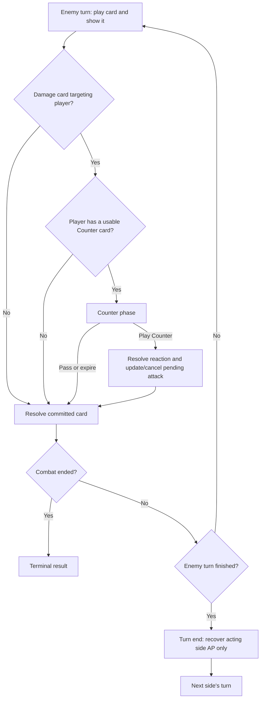

# Cinematic QTE — Design

Status: revised design draft; gameplay changes NOT IMPLEMENTED. Updated: 2026-10-14.
Upstream: [PRD](prd.md); latest user correction takes precedence over its earlier Response-loop requirements.

## Turn-based combat contract

The game is a turn-based card battle. A **turn** belongs to one acting side; a **Counter phase** is a reaction inserted into that turn, not a separate turn. A round/cycle, if retained for UI or cooldown counting, must not be conflated with a single enemy attack. The old enemy wind-up → player Response → player ordinary actions → Counter sequence below is superseded for future implementation. Existing source code and previous verification still describe that old playable prototype.

Confirmed enemy-turn flow:

1. The enemy plays a card. Commit the card and show it in the upper-right immediately, before checking reactions; its presentation must not depend on Counter being available.
2. Inspect the committed card's effect. If it is a damage card targeting the player, check whether the player has at least one **currently usable** Counter-tagged card. A non-damage card bypasses the Counter check and resolves its own effect.
3. If a usable Counter card exists, enter the bounded Counter phase before applying the incoming damage. Slow motion, close framing and diagonal black bars communicate the reaction opportunity.
4. The player may play an eligible Counter card or pass. A valid play consumes its cost once and resolves its defined effect. For the existing prototype Counter, cancel the pending enemy attack and deal 2 damage. Pass/expiry leaves the enemy card pending for normal resolution.
5. If no usable Counter exists, proceed directly to the enemy card's resolution. Do not open an empty reaction window or a generic Response phase.
6. Finish that card's effects, damage and terminal checks. Continue the enemy turn if its future turn rules allow more cards; otherwise end the turn. An individual card finishing does not itself imply that the turn has ended.
7. At the turn-end boundary, recover only the acting side's AP once, then hand control to the next side. The other side's AP remains unchanged. Terminal combat stops further transitions and recovery.

There is **no Response phase during an enemy turn**. The player cannot play ordinary attack or Guard cards during that turn merely because AP or time remains. A Counter resolves back into the pending enemy-card sequence, never into ordinary player selection. Ordinary player card selection belongs to the player's own turn; its detailed sequence and timing remain to be agreed.

## Counter eligibility and resolution ownership

A usable Counter must be present in the player's current hand, carry the Counter tag, satisfy the incoming event's targeting/trigger restrictions, be out of cooldown, be unused under the applicable usage limit, and be affordable with current player AP. Merely owning a Counter card is insufficient. Revalidate these conditions when the player actually submits a reaction; reject invalid or repeated input without spending AP or resolving effects. Current fixed-card costs/effects are provisional values, not a new commitment to a full hand/deck system.

Combat owns the active side, turn boundary, committed enemy card and pending effect, reaction eligibility, AP, cooldown and terminal state. Presentation reads snapshots and events; it must not infer the acting side from the camera, animation or UI label. The pending card is committed once, with one resolution/cancellation outcome. One incoming card opens at most one Counter phase in this revision; reactions do not trigger recursive Counter chains. Lethal reaction damage ends combat and cancels the pending enemy action immediately.

## AP timing and open decisions

AP recovers **at turn end**, not on entering Response, opening/closing Counter, finishing an individual card, or starting the next turn. Counter uses the player's current AP; no resource refill may be inserted immediately before the eligibility check to make it available. Initialization may set starting AP without counting as a turn-end recovery. Pause and restart must not create duplicate recovery events.

Each side owns a separate AP balance. Only the side whose turn is ending receives recovery: player-turn end recovers player AP; enemy-turn end recovers enemy AP. A reacting player is not the acting side of the enemy turn. AP spent on Counter therefore remains spent after the enemy turn ends and is recovered only when the player's own turn subsequently ends. Passing a reaction does not change either AP balance. Recovery amount remains an open balance decision below.

The following details are intentionally unresolved and block gameplay implementation readiness:

- Turn order/first actor; whether an enemy turn plays one card or several and what ends it.
- Player-turn selection, permitted ordinary cards, decision timer and explicit end-turn behavior. The old 4-second Response loop is not automatically carried into this design.
- Whether recovery refills to maximum or adds a fixed amount, and the cooldown/once-per-turn counting boundary after distinct side turns are introduced.
- Guard duration across the player/enemy turn boundary; the current guard-clearing rule cannot be copied without specifying when its protection expires.

## Timing, lifecycle and scope

Enemy-card anticipation is presentation inside the enemy turn, followed by the eligibility check before damage. Counter decision time uses real seconds while scene animation slows; any ordinary player-turn time budget is separate and currently unspecified. Pause freezes both simulation and presentation, clears held input on focus loss and resumes without consuming hidden time. Restart clears the active turn, pending card, reaction, AP-recovery markers, cooldown and visual state. Preserve screen buttons, keyboard and portrait touch support.

This revision authorizes design only: no Combat/API/state-enum migration, UI rewiring, test expectation changes or balance changes are included. Previous PRD, implementation plan, tasks and acceptance evidence remain records of the older implementation and must be reconciled before a later implementation task. No new rules are verified by the previous test passes.

Design-review scenarios for future implementation: damage with eligible Counter; damage without Counter due to hand/AP/cooldown; non-damage card; Counter pass/expiry; repeated input; lethal Counter; multiple cards with no AP recovery between them; single turn-end recovery for the acting side only; Counter spending persisting into the player's next turn until that turn ends; pause/resume and restart across reaction/turn-end boundaries. These are planned checks, not executed gameplay tests.

## Retained cinematic presentation

A small presentation camera director selects authored, same-side poses by phase, active card and observed HP/guard/counter changes. The stable establishing, wind-up, decision and Counter-window axis sits immediately behind the player's right shoulder: the player frames the foreground while the opponent remains the focal point. Quick, Heavy, Guard, parry, impact and terminal events use lower or more oblique panels without crossing the combat axis. Counter immediately overrides an earlier impact hold, pushes closer to the opponent and adds animated top/bottom bars for the slow-time decision. The upper bar travels diagonally from the upper-right while the lower bar travels diagonally from the lower-left; opposite temporary tilts settle into asymmetric trapezoids that leave the combat center open. Bounded real delta drives transitions; a brief impact/parry hold otherwise survives phase advancement. No camera event mutates Combat. Decision poses settle and remain stable; pause freezes pose and hold timers; reset discards previous transitions; reduced motion uses the right-shoulder overview without dolly/shake and snaps the bars instead of sliding them. Arena publishes current shot as a canvas data attribute for accessible inspection/tests, with no gameplay-control hook (FR-04–05).

HTML buttons share one input adapter with keyboard and touch. Preserve immediate card activation and snapshot-based availability; future prompts must identify the acting side and separate ending a turn from passing a Counter. The previous QTE/queue comparison behavior is historical and requires a separate compatibility decision before migration. Committing any enemy card reveals it in the upper-right playfield, whether or not a Counter window opens. It derives attack name and damage from the snapshot and enters with a short fade, translation, rotation and overshoot; it remains visible through that card’s resolution and is replaced by the next enemy card or cleared after its presentation finishes. If Counter is unavailable because of AP or cooldown, the already-visible enemy card resolves directly; black bars remain tied to the Counter presentation. Pause freezes the animation and reduced-motion preference uses a fade only. Mode changes replace the Combat instance only in ready/terminal states, preserve focus gating and reset render baselines. Existing native history interaction remains independent.

Arena observes the same HP and Guard boundaries to trigger pooled presentation effects: attack damage emits an 18-point dark-red burst and a fully absorbed Guard emits 14 additive metal-spark streaks. Fixed typed arrays, shared geometries and materials avoid per-frame allocation. The WebGL frame is composed as scene base, black-bar insert, actors, then feedback/effects; the actor redraw lets silhouettes cross the bars and the last effect pass keeps impact particles readable. Renderer diagnostics are exposed for capture alongside the order. No new dependency, asset or draw loop. Camera uses bounded interpolation and reusable vectors; FOV updates only on change. Risks: close shots hide threat, event holds leak into restart, QTE resets time or permits repeated cards, and the added actor/effect passes increase draw calls. Unit/browser tests, renderer diagnostics and actual motion/viewport capture cover these, while human perception of cinematic quality remains a playtest question.
